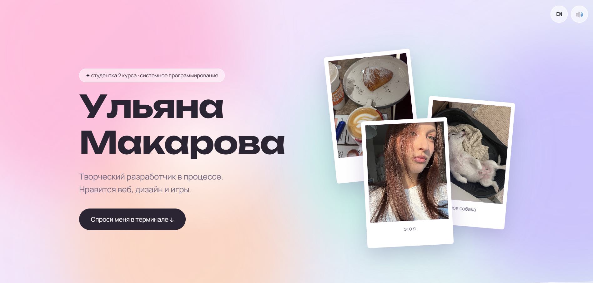

# Ульяна Макарова · личный сайт ✦

Сайт-визитка студентки 2 курса с анимированным пастельным фоном, фотографиями-полароидами, таймлайном и **терминалом вместо меню**: на сайте можно вводить команды и узнавать обо мне. Есть русская и английская версии.

🔗 **Сайт:** https://ulyanamakarova.ru/



## Что на сайте

- **Терминал-навигация.** Команды: `about`, `timeline`, `skills`, `projects`, `hobbies`, `photos`, `contacts`, `neofetch`, `theme`, `dance`, `confetti`, `lang`, `clear`, `help`. Работают автодополнение по Tab, история стрелками и быстрый ввод по клавише `/`. Под терминалом есть кнопки-подсказки для телефонов.
- **Таймлайн «Мой путь»:** цветная линия растёт при прокрутке, карточки событий появляются по очереди.
- **Анимации:** плавающий пастельный градиент, свет за курсором, искорки, фото-полароиды с параллаксом, бегущая лента, конфетти по клику на имя.
- **Звук.** Реальные щелчки клавиш нарезаны из записи и играют при наборе в терминале (с кнопкой включения и выключения). Если файл не загрузился, включаются синтезированные клавиши.
- **Две языковые версии (RU / EN)** с переключателем и командой `lang`. Выбор запоминается, а язык по умолчанию берётся из настроек браузера.
- **Темы цвета** (команда `theme`): розовая, мятная, лавандовая, персиковая.
- Адаптивная вёрстка, уважение к настройке «уменьшить анимации», собственная иконка сайта.

## Технологии

HTML, CSS и JavaScript без библиотек и фреймворков. Использованы Web Audio API, `IntersectionObserver`, `<canvas>` (конфетти), `localStorage` (язык, тема, звук), шрифты Unbounded, Manrope и JetBrains Mono.

## Структура проекта

```
├── index.html     # разметка страницы
├── card.css       # оформление и анимации
├── card.js        # данные обо мне (RU/EN), терминал, звук, таймлайн, эффекты
├── typing.mp3     # нарезка звуков клавиш
├── favicon.svg    # иконка сайта
├── icon.png       # иконка для iPhone
├── photo1.jpg …   # мои фотографии
└── README.md
```

## Запуск локально

1. Склонируй репозиторий:
   ```bash
   git clone https://github.com/weqsvert/my-persCard.git
   ```
2. Открой папку в VS Code и запусти `index.html` через расширение Live Server. Через двойной клик по файлу звук клавиш не загрузится: браузеры запрещают читать файлы без сервера.

## Как изменить данные

Все тексты, навыки, проекты, хобби, подписи к фото и события таймлайна находятся в начале `card.js`: русские в объекте `ME`, английские в `ME_EN`. Фотографии кладутся рядом с `index.html` под именами `photo1.jpg`, `photo2.jpg` и так далее.

## Контакты

- Telegram: [@weqsvert](https://t.me/weqsvert)
- GitHub: [weqsvert](https://github.com/weqsvert)

## Примечание

Проект учебный, сделан в рамках лабораторной работы и развивался дальше по моей инициативе.